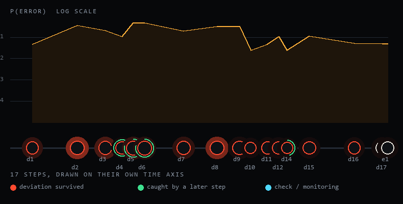

# MURPHY

**Fuzz the procedure, not the plant.**

MURPHY compiles a written operating procedure into an executable model, runs
thousands of simulated crews through it against a physics twin of the equipment,
and reports where the sequence breaks, what it costs per year, and which edit
measurably fixes it. Human error rates come from three published reliability
methods — SPAR-H, THERP and HEART — and a finding is only called robust when the
ranking of failure modes survives a change of method. Every number on screen is
traceable to a named row of a named source table.

## Why this exists

Software has had fuzzing for forty years. A parser is thrown at with ten million
malformed inputs before it meets a customer, and continuous integration runs the
same checks on every change. High-hazard operations have neither. A procedure is
reviewed in a meeting, signed, filed in the controlled document system, and then
performed at three in the morning by a tired person on a tank that has had
instrument work. Nobody ever ran the sequence. The signature is the only test it
ever got. MURPHY is the missing test pass: it puts the paperwork under load
before the plant is.

## What it says about one real procedure

Same document — `OP-TRF-014` rev 7, a 55 m³ flammable-liquid transfer into an
atmospheric storage tank — different plant state and different crew.

| Plant state | Competent day crew | Night trainee |
| --- | --- | --- |
| `tk_asdesigned` | 0.70% of shifts lost | 5.72% of shifts lost, EUR 0.69M/yr |
| `tk_after_instrument_work` | 10.87% of shifts lost, EUR 1.63M/yr | 42.88% of shifts lost, EUR 5.8M/yr |
| `tk_uprated` | 10.87% lost, 9.2% breach the roof, EUR 12.1M/yr | 42.75% lost, 32.1% breach the roof, EUR 42.9M/yr |

Reproduce with `npx tsx scripts/figures.ts`, which runs the console's own default
configuration — same seed, same 6,000 shifts — so every figure above is what the
deployed application prints when those two dropdowns are set that way and Run is
pressed. `npx tsx scripts/smoke.ts 4000` sweeps the whole model on its own seeds
and lands within a few tenths of a percent of these. Both numbers moved when the
reliability layer was corrected twice after this table was first written, which is
the reason the command is part of the README and not a footnote.

The post-maintenance state is dominated by two stations: `d8`, confirm the tank
vent is open, at a modelled 9–33% per performance depending on the crew, and
`d2`, reconcile the instrument isolation register, at about 12–38%. Both failures
are introduced by maintenance work the procedure never mentions.

Outcomes are classed normal, upset or incident on purpose. An aborted batch and a
loss of containment are not the same event, and a plant reports them on different
sheets to different people.

On this procedure the three reliability methods do **not** agree. The same batch
reads 43.00% under SPAR-H, 83.70% under THERP and 97.60% under HEART, and only one
of the top three stations is common to all three. The Pressure test view says that
in those words rather than quoting whichever number flatters the argument, which is
the reason the ranking is offered as a hypothesis to reconcile against site data and
not as a result.

Against published investigation findings (`data/bench/backtest.md`): 13 causes
across 3 cases, about 60 candidate mechanisms ranked per case. 7 landed inside
the model's top 10 (54%), 11 inside its top 20 (85%), 0 were never raised. A
random top 10 would catch about 17%.

## Run it

```bash
npm ci
npm run dev          # then open http://localhost:3000
npm test             # engine and simulation suites
npm run build        # production build of the app
npm run golden       # regenerate data/golden fixtures
npx tsx scripts/figures.ts          # the figures quoted above, on the console's own seed
npx tsx scripts/figures.ts 6000 --repair   # ... and the repair loop on that case
npx tsx scripts/backtest.ts   # rewrite data/bench/backtest.md
npx tsx scripts/smoke.ts 3000 tk_after_instrument_work
```

Everything above runs on a laptop with no GPU and no network. The engine is
TypeScript; the same kernel runs in a browser worker, in a Node route, and in a
batched PyTorch service.

## Attach the AMD batched service (optional)

The service in `services/gpu` is an accelerator, not a requirement. **The browser
engine is the reference implementation.** It is a FastAPI app (`murphy_gpu/api.py`,
serving `/health`, `/run`, `/bench`, `/equivalence` and `/configurations`), and
`services/gpu/README.md` explains what was ported, what was not, and how it is
held to the same fixtures. To build and run it on an AMD host:

```bash
docker build -f services/gpu/Dockerfile -t murphy-gpu .
docker run -d --device /dev/kfd --device /dev/dri -p 8080:8000 murphy-gpu
python services/gpu/verify_golden.py     # reproduce the equivalence table
python services/gpu/bench.py --batches 1000,10000,100000 --device both
```

To point the app at a service that is already running:

```bash
AMD_GPU_URL=http://10.0.0.21:8080 npm run dev
```

With the variable unset, or when the service does not answer, the Node engine
runs the batch and the header chip says `amd not attached`. The interface never
shows a machine it does not have.

## Environment

Presence is what changes behaviour. Values stay server-side and are never sent to
the browser; the health route reports whether each is set, not what it is.

| Variable | Effect when present |
| --- | --- |
| `AMD_VLLM_BASE_URL` | Base URL of your own OpenAI-compatible inference service; agents stop using their deterministic paths |
| `AMD_VLLM_MODEL` | Exact served model name; with the base URL, enables the four model-backed agents |
| `AMD_VLLM_API_KEY` | Bearer token sent to that service; absent means the endpoint is assumed unauthenticated |
| `AMD_GPU_URL` | Batched PyTorch engine; batches go to the accelerator and the UI names the device |
| `EVOLUS_API_KEY` | Credentials for the approval workflow and document extraction calls |
| `EVOLUS_APP_ID` | Space identifier, sent as `X-Application-Id` and used to build the agent model id |
| `EVOLUS_WORKFLOW_CHANGE_ORDER` | Workflow that approves a change order; unset means change orders are drafted but not routed |
| `EVOLUS_AGENT_ID` | Agent used for knowledge-library questions and file extraction |

`.env.example` documents these and the remaining tuning variables.

## What the model contains

| Part | Count | Lives in |
| --- | --- | --- |
| Process twins | 3 - tank transfer, furnace light-off, furnace on production | `src/engine/twins/` |
| Controlled procedures compiled to models | 3 (17, 15 and 18 steps) | `data/procedures/` |
| Crews | 6 | `data/personas.json` |
| Plant states | 11 | `data/plants.json` |
| Diagnosis benchmarks measured | 3 (procedure x plant state) | `data/bench/diagnosis.json` |
| Human reliability methods | 3 | `src/engine/hra.ts` |
| Candidate controls | 12 | `src/engine/repair.ts` |
| Site conditions | 19 | `src/engine/conditions.ts` |



*Generated from a live run by `python scripts/poster.py`, which also writes
`public/cover.png` - so the picture cannot disagree with what the app produces.*

## What is on screen

| View | Question it answers |
| --- | --- |
| Line map | where on the procedure's own time axis the line breaks, and whether a later step caught it |
| Pressure test | how the ranking moves when the crew, the plant state or the reliability method changes |
| Black box | one failed shift, replayed from its seed, plant and tape on the same clock |
| Cause finder | given an instrument window and nothing else, which error mode produced it - and whether the window says anything at all |
| Change lab | whether a proposed edit measurably reduces failure, paired against the same crews and seeds, before anyone signs it |
| Evidence | which machine answered, how long it took, and what the whole model does not prove |

## Read further

- `docs/METHOD.md` — where every probability comes from, and what the backtest does not prove.
- `docs/ARCHITECTURE.md` — modules, the determinism contract, and how to add a third twin.
- `/method` in the running app — the same method story, with the worked example computed live.

## LIMITATIONS

Say these out loud before you show the tool to anybody.

Human reliability data are order-of-magnitude screening values. The source
documents themselves say so. Every probability in this repository is reported
with a band around it, and the band is wide on purpose. A figure of 0.4% and a
figure of 1.2% from this model are the same number.

A simulated crew is a hypothesis about a crew. It is built from years of
experience, hours into a shift, prior runs of this procedure and a language, not
from a person's records. It is a way of asking "who would this break for", and it
is not a substitute for watching the people who actually do the job.

The process twins are engineered surrogates. They state mass balance, pump
dead-heading, vapour-space pressure and bund capacity in words and in arithmetic.
They were checked against the mechanics published in incident investigations, not
against CFD, and they do not resolve a flow field. Use them to compare procedures
with each other, not to size a relief valve.

A change order only becomes real when a competent person signs it. The paired
test, the cost gate and the false-discovery correction decide whether an edit is
worth proposing. They do not authorise it. Management of change, a field walkdown
and a signature are the parts that carry legal weight, and MURPHY does not replace
any of them.

## License

MIT. See [LICENSE](LICENSE). The engine, the twins and the data files are all
covered by it.
